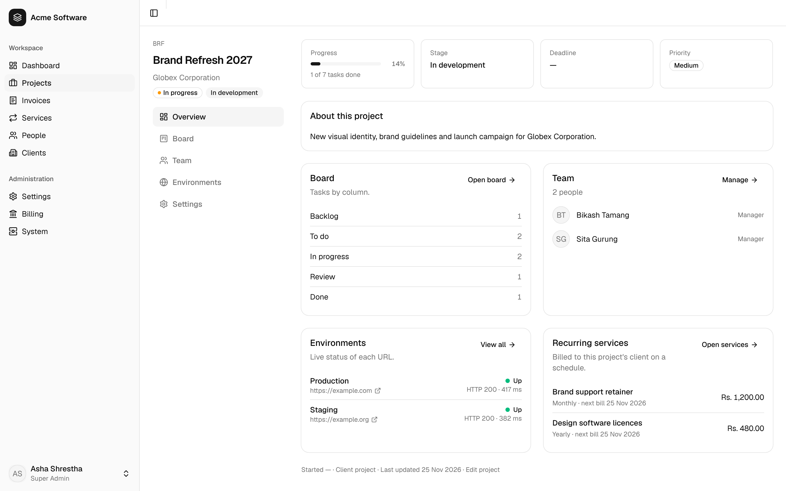
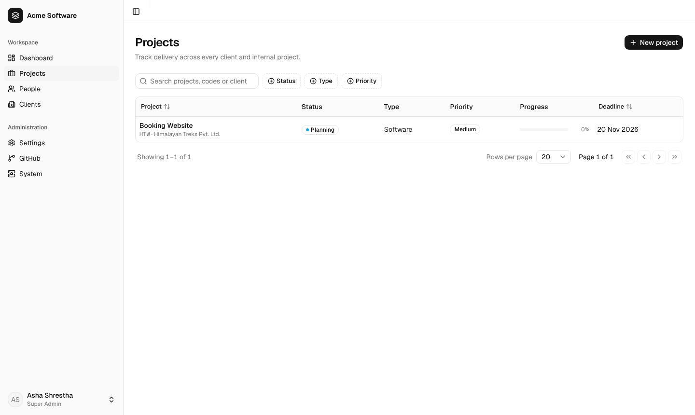
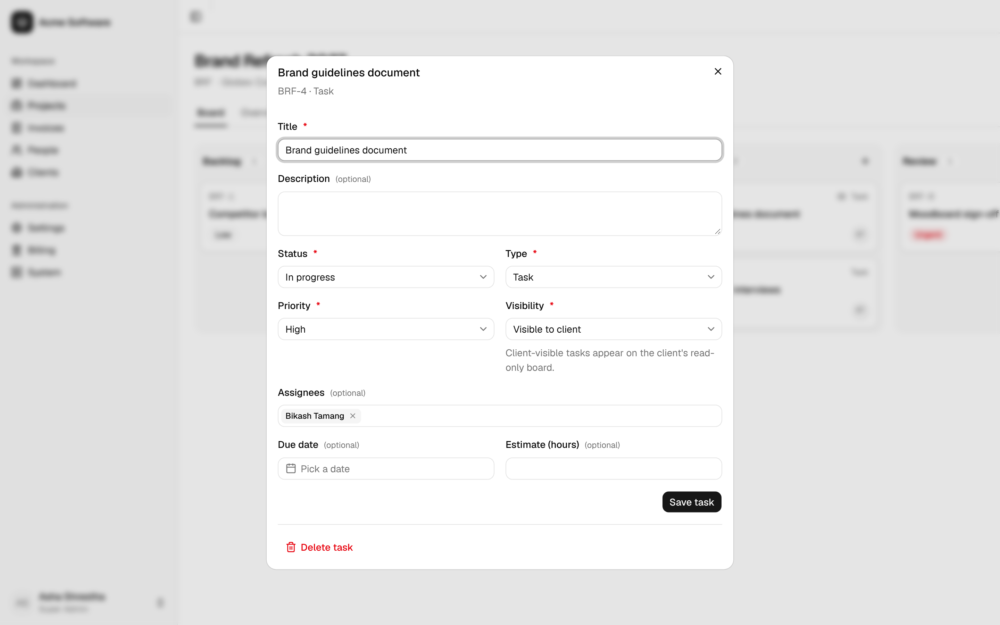
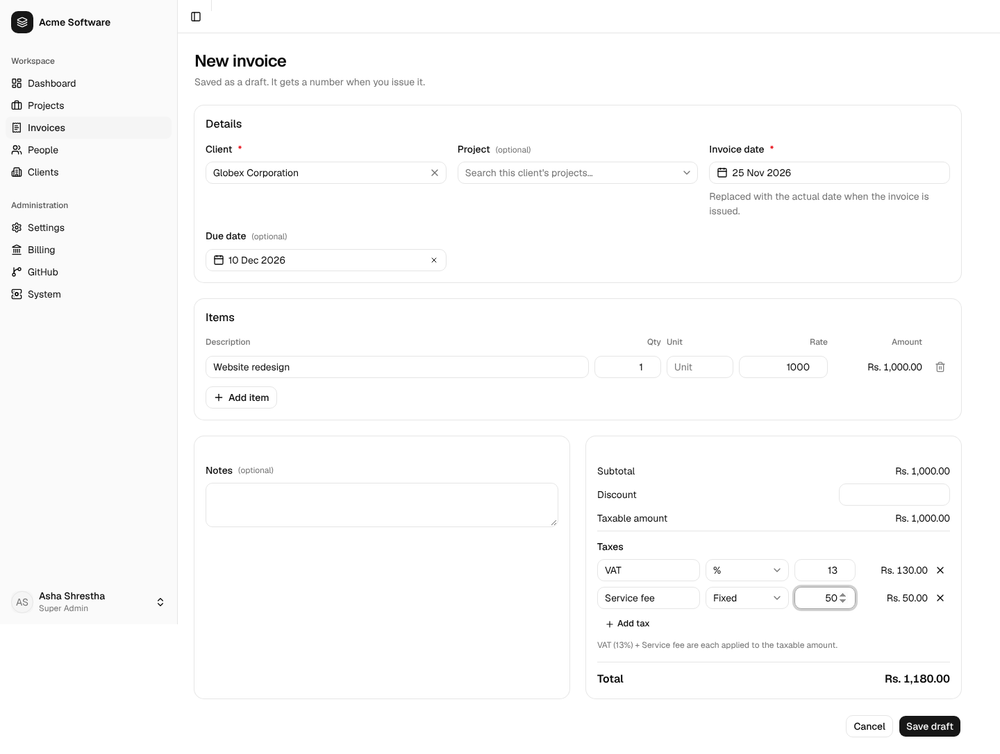
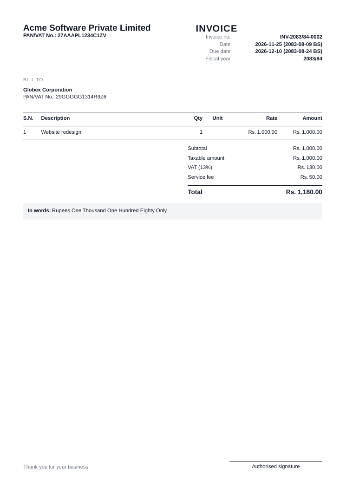
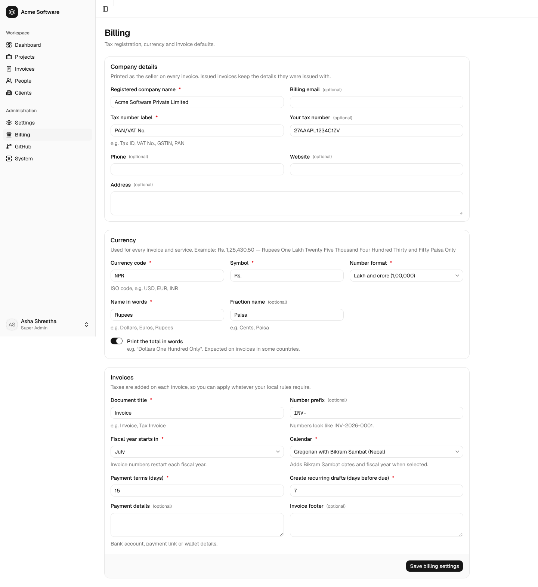
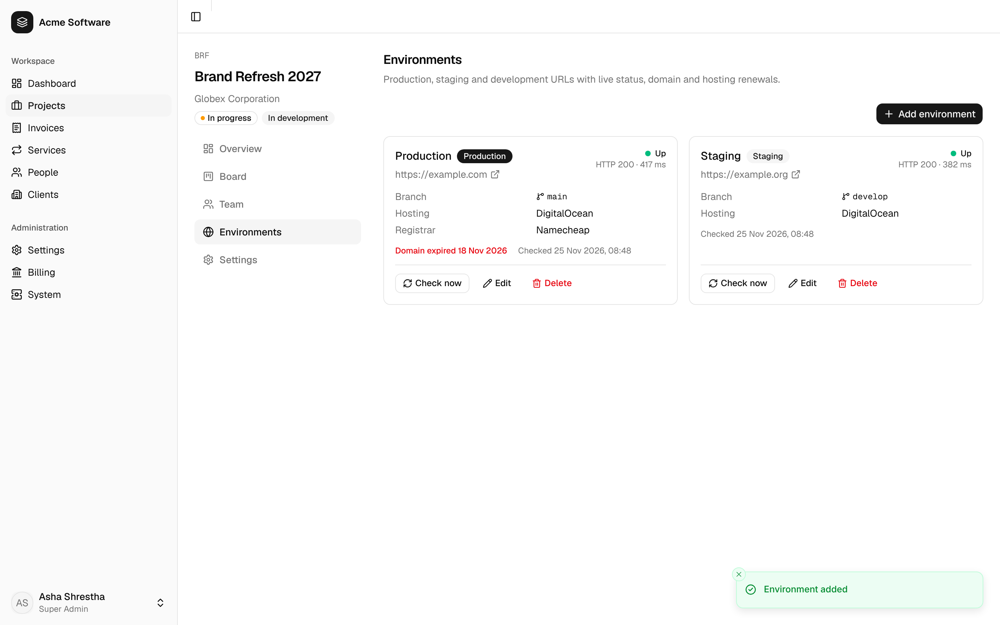
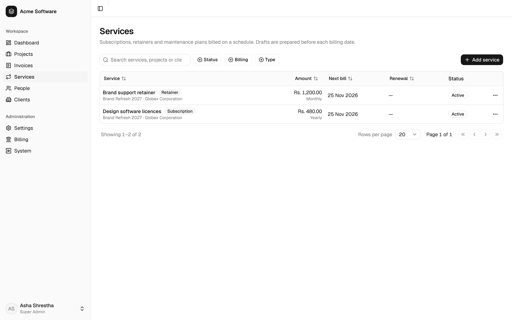

<div align="center">

# KaamHub

**The open-source workspace to run your business: projects, people, clients and billing in one place.**

Projects and Kanban boards, employees and freelancers, clients with their own portal, invoicing with whatever taxes you need, and recurring billing for subscriptions and retainers. Built for agencies, consultancies, studios, IT companies and any team that delivers work for clients. Turn on only the modules you need. Self-hosted on your own server, updated in one click.

[](https://github.com/klixsoft/kaamhub/actions/workflows/ci.yml)
[](https://github.com/klixsoft/kaamhub/releases)
[](LICENSE)
[](https://nextjs.org)
[](https://www.postgresql.org)

```bash
curl -fsSL https://github.com/klixsoft/kaamhub/releases/latest/download/install.sh | sudo bash
```

[Features](#features) · [Screenshots](#screenshots) · [Quick start](#quick-start) · [Deploy](#deploy-on-your-own-server) · [Docs](#documentation) · [Roadmap](#roadmap) · [Contributing](#contributing)



</div>

---

## Why KaamHub?

*Kaam* (काम) means **work** in Nepali.

Most service businesses run on a patchwork of tools: one for tasks, a spreadsheet for staff, email threads for client updates and another app for invoices. KaamHub puts the day-to-day running of the business in one place that you own:

- **One source of truth** for projects, people, clients and code access.
- **Clients see progress** on a read-only board without seeing your internal work, and receive invoices from the same place.
- **Bill anywhere.** Add any taxes per invoice (percentage or fixed), with your own currency, fiscal year and numbering.
- **Never miss a renewal.** Subscriptions, retainers and maintenance plans are billed on schedule and renewals are flagged before they expire.
- **Only what you need.** Clients, invoices, recurring services and GitHub are modules you switch on or off.
- **Your data stays on your server.** It is a single Docker Compose stack with PostgreSQL, so there is no per-seat pricing and no vendor lock-in.
- **Built to be extended.** It is a clean, typed Next.js codebase with documented patterns, so your team can add what your company needs.

---

## Features

### Projects and Kanban boards
- A **project workspace** with its own side menu: Overview, Board, Documents, Team, Environments, Repositories and Settings
- **Project documents**: upload requirements (SRS), designs, contracts and other files for the whole project team, and share chosen ones with the client. PDF, Office, OpenDocument, text, images and ZIP up to 25 MB, stored on your own server
- **Overview** shows progress, stage, deadline, team, live environment status, linked repositories and recurring services together
- Project **stages** (e.g. In development, Live, Support and maintenance) from your own list
- A **full-page board**: the main menu collapses and opens as an overlay, so the board gets the whole screen
- Projects with code, client, type, priority, status, start date and deadline
- A Kanban board for every project with drag and drop by **mouse, touch or keyboard**
- Optimistic updates with automatic rollback if the server rejects a move
- Tasks with type (task, feature, bug, improvement), priority, multiple assignees, due date, estimate and description
- Readable task IDs per project, e.g. `WEB-42`
- Per-task visibility: **internal** or **visible to client**
- Progress per project based on completed tasks
- **Card details** like Trello: description, checklist with progress, threaded discussion and a full activity log of every change
- Comments are **internal** or **shared with the client**, and each author is labelled **Staff** or **Client**
- **@mentions**: pick a teammate from the comment box to mention them
- **Attachments** on cards (screenshots, mockups, documents up to 25 MB), internal or shared with the client
- Shareable card links (`?task=42`) open the card directly

### Notifications
- A bell in the top bar shows what needs your attention, with an unread count
- You are notified when someone assigns you a card, @mentions you, or comments on a card assigned to you
- Project managers are notified when a client comments
- Assignments, mentions and client comments are also emailed once email is set up

### Client portal
- Invite people from a client company; they set their own password
- Clients only ever see **their own company's projects**
- A read-only board that shows only client-visible tasks
- Clients can **join the discussion** on client-visible cards and attach files; they only see comments and files shared with them
- Clients can open and download documents shared with them
- Internal sections (team, repositories, people, settings) are blocked for clients

### Invoicing that works in any country
- **Manual tax lines** on each invoice: any name, as a percentage of the taxable amount or a fixed amount (VAT, GST, sales tax, service charge, or none)
- Global currency setting with symbol, number format (100,000 or 1,00,000) and optional **total in words**
- Fiscal-year based numbering with your own prefix, e.g. `INV-2026-0001` or `INV-2026-27-0001`
- Optional **Bikram Sambat** dates and fiscal year
- Draft → issue → partial or full payment → paid, with cancellation instead of deletion once issued
- **Credit notes** against issued invoices, with their own numbering and PDF; balances and statuses update automatically
- Seller and buyer details are frozen when an invoice is issued
- **A4 PDF** generated on the server with your logo, downloadable and emailed to the client with one click
- PDFs embed Noto Sans fonts, so Devanagari text and symbols such as `₹` and `€` print correctly
- Clients see their invoices in the portal

### Websites and environments
- Production, staging and development environments per project, with URL and branch
- Hosting provider, domain registrar, and **domain and hosting expiry dates** with reminders
- **Uptime checks** every hour, with HTTP status and response time, plus a "Check now" button
- One tab per environment, each with its own **test credentials** (username, password, login URL and notes)
- Credentials are **encrypted at rest** (AES-256-GCM) and revealed on demand; every reveal is written to the audit log
- Share a credential with **chosen team members**, or leave it open to the whole project team. Clients never see credentials

### Recurring services
- One **Services** page for every subscription, retainer and maintenance plan, with search and filters by status, billing cycle, type and project
- Track subscriptions, retainers, support plans or maintenance per project, with supplier and renewal date
- Service types are your own list, managed in Settings
- Monthly, quarterly, half-yearly or yearly billing; **draft invoices are created automatically** before each period, never twice
- Renewal reminder emails 30, 7 and 1 day before expiry, and a renewals list on the dashboard

### People and freelancers
- Invite employees and freelancers by email
- Seven system roles: **Super Admin, Admin, HR, Project Manager, Employee, Freelancer, Client**
- Department, designation, reporting manager, employee code, phone, joining date and contract end date
- **Freelancer access expiry**: sign-in (and GitHub access, if enabled) stops automatically on the date you set
- Deactivate or reactivate with one click; deactivation signs the person out everywhere immediately

### Company letters
- Issue **offer letters, appointment letters, NDAs, experience letters and salary certificates** on your own letterhead
- Upload your letterhead once as a full A4 image and set the top, bottom and side margins; long letters continue onto new pages with the letterhead repeated
- Templates with placeholders such as `{{recipient.name}}`, `{{recipient.designation}}` and `{{company.name}}`, filled from the person's profile; your own placeholders such as `{{salary}}` are asked for when issuing
- Five starter templates to adapt, or write your own with simple formatting: paragraphs, headings, bullets and bold
- Every letter gets a yearly number (`LTR-2026-0001`), is emailed as a PDF and can be revoked with a reason
- **My letters** on each person's profile, so employees can download their letters any time

### GitHub integration (optional module for software teams)
- Off by default; enable it in Settings → Modules
- Connects to your organisation through a **GitHub App** with minimal permissions
- Link **several repositories to one project** (frontend, backend, mobile, infrastructure, docs)
- Create new organisation repositories without leaving the project
- Team members connect their GitHub account from their profile
- **Automatic access by project role**, configurable per role (e.g. Manager → Maintain, Member → Write, Viewer → Read); when someone has several roles, the strongest permission wins
- Access is removed when someone leaves a project, is deactivated or their freelancer access expires
- Per-repository, per-person status: *Active*, *Invitation sent* or *Failed*, with the reason
- A webhook keeps the repository list in sync

### Modules and categories
- Switch **Clients**, **Invoices**, **Recurring services**, **Websites and environments** and **GitHub** on or off; disabled modules disappear from the app and their data is kept
- Your own **project categories**, **project stages** and **service types**
- Generic project roles: **Manager**, **Member** and **Viewer**

### Administration
- First-run setup screen that creates the first super admin
- Company name, project code prefix, departments and designations
- Audit log of invitations, role changes, project, repository and settings changes, and updates
- **One-click updates**: KaamHub checks GitHub Releases and updates its own containers, similar to Dokploy

### Built for production
- **Fast lists**: server-side search, facet filters with live counts, sorting and pagination
- **No N+1 queries**: every list runs a fixed number of SQL queries regardless of size
- **Instant page shells** with Partial Prerendering; data streams in behind skeletons
- **Secure by default**: invite-only accounts, rate-limited sign-in, permission checks on every query and action, strict security headers, a non-root container and signed webhooks
- **Accessible**: labelled forms, keyboard support, visible focus, and dark mode

---

## Screenshots

| Sign in | Projects |
|---|---|
|  |  |

| Task editor | Project team |
|---|---|
|  |  |

| Invoice with tax lines | Invoice PDF |
|---|---|
|  |  |

| Billing settings | |
|---|---|
|  | |

| Full-page board | Environments with uptime |
|---|---|
|  |  |

| People with facet filters | Services |
|---|---|
|  |  |

---

## Tech stack

| Layer | Technology |
|---|---|
| Framework | [Next.js 16](https://nextjs.org) (App Router, Server Actions, Cache Components) |
| Language | TypeScript (strict) |
| UI | [shadcn/ui](https://ui.shadcn.com) on Base UI, Tailwind CSS 4, lucide icons |
| Database | PostgreSQL with [Drizzle ORM](https://orm.drizzle.team) |
| Auth | Built-in: [iron-session](https://github.com/vvo/iron-session) sealed cookies with rotating refresh tokens in PostgreSQL |
| Drag and drop | [dnd-kit](https://dndkit.com) |
| PDF | [react-pdf](https://react-pdf.org) |
| Validation | [zod](https://zod.dev) |
| GitHub | GitHub App via [Octokit](https://github.com/octokit) |
| Deployment | Docker, Docker Compose, GitHub Actions, GitHub Container Registry |

---

## Quick start

Requirements: **Node.js 22+** and **PostgreSQL 15+**.

```bash
git clone https://github.com/klixsoft/kaamhub.git
```

```bash
cd kaamhub && npm install && cp .env.example .env.local
```

Set `DATABASE_URL`, `SESSION_SECRET` and `ENCRYPTION_KEY` in `.env.local` (generate each secret with `openssl rand -hex 32`), then:

```bash
npm run db:migrate
```

```bash
npm run dev
```

Open <http://localhost:3000>. You will be taken to **/setup** to create the first super admin.

> Without SMTP settings, invitation and password emails are printed to the server log, so you can try every flow locally.

Full guide: [docs/development.md](docs/development.md)

---

## Deploy on your own server

On any Linux VPS, one command installs Docker if needed, asks for your domain, generates all secrets and starts KaamHub with automatic HTTPS:

```bash
curl -fsSL https://github.com/klixsoft/kaamhub/releases/latest/download/install.sh | sudo bash
```

Then open `https://your-domain/setup` to create the first administrator. Point your domain's DNS A record at the server before running it.

The command always installs the latest release, with configuration files that match its version. To try unreleased changes from `main`, use `https://raw.githubusercontent.com/klixsoft/kaamhub/main/scripts/install.sh` instead.

### Run with Docker Compose

Prefer to set it up yourself? KaamHub publishes ready-made images for `linux/amd64` and `linux/arm64`:

| Image | Purpose |
|---|---|
| `ghcr.io/klixsoft/kaamhub:<version>` | The application. Applies database migrations on start and serves on port 3000 |
| `ghcr.io/klixsoft/kaamhub-updater:<version>` | Optional helper for one-click updates and the hourly scheduled job |

Download the Compose files for a release into a folder:

```bash
mkdir -p /opt/kaamhub && cd /opt/kaamhub
```

```bash
curl -fsSL https://raw.githubusercontent.com/klixsoft/kaamhub/v0.1.0/docker-compose.yml -o docker-compose.yml
```

```bash
curl -fsSL https://raw.githubusercontent.com/klixsoft/kaamhub/v0.1.0/docker/Caddyfile -o Caddyfile
```

```bash
curl -fsSL https://raw.githubusercontent.com/klixsoft/kaamhub/v0.1.0/.env.production.example -o .env && chmod 600 .env
```

Fill in `.env` (your domain, `APP_URL` and the generated secrets), then start the stack:

```bash
docker compose up -d
```

Open `APP_URL/setup` to create the first administrator. The stack runs PostgreSQL, the app, the updater and, with `COMPOSE_PROFILES=https`, Caddy for automatic HTTPS. Your data lives in the `db-data` and `app-storage` volumes.

The [deployment guide](docs/deployment.md) explains every step in detail:

- [generating the secrets](docs/deployment.md#3-generate-the-secrets) and [every environment variable](docs/deployment.md#environment-variables)
- [domain with HTTPS, your own reverse proxy, or IP only](docs/deployment.md#4-choose-how-people-reach-kaamhub)
- [using your own PostgreSQL](docs/deployment.md#use-your-own-postgresql), including Portainer, Dokploy and Coolify
- [backups](docs/deployment.md#backups), [everyday commands](docs/deployment.md#everyday-commands) and [troubleshooting](docs/deployment.md#troubleshooting)

### Updating

Open **System** in the sidebar. When a new release is available, click **Update**. KaamHub pulls the new image, restarts, applies migrations and reloads the page when it is back. You can also update manually with `docker compose pull && docker compose up -d`.

---

## Roles and permissions

| Capability | Super Admin | Admin | HR | Project Manager | Employee | Freelancer | Client |
|---|:-:|:-:|:-:|:-:|:-:|:-:|:-:|
| Dashboard | ✓ | ✓ | ✓ | ✓ | ✓ | ✓ | |
| See all projects | ✓ | ✓ | | | | | |
| See assigned projects | ✓ | ✓ | ✓ | ✓ | ✓ | ✓ | |
| See own company's projects (read-only) | | | | | | | ✓ |
| Create projects | ✓ | ✓ | | ✓ | | | |
| Manage any project | ✓ | ✓ | | | | | |
| View people | ✓ | ✓ | ✓ | ✓ | | | |
| Invite and edit people | ✓ | ✓ | ✓ | | | | |
| View clients | ✓ | ✓ | ✓ | ✓ | | | |
| Edit clients | ✓ | ✓ | | | | | |
| Invoices and services | ✓ | ✓ | | | | | |
| See own company's issued invoices | | | | | | | ✓ |
| Settings, billing and GitHub | ✓ | ✓ | | | | | |
| System updates | ✓ | | | | | | |

Inside a project, the **project role** decides what someone can do: Managers manage the project and team, Members work on tasks, and Viewers are read-only. Anyone who is a Manager on a project can manage that project, whatever their system role.

All permissions are defined in one file: [`src/config/roles.ts`](src/config/roles.ts).

---

## Documentation

| Guide | What it covers |
|---|---|
| [Development](docs/development.md) | Local setup, scripts and database migrations |
| [Architecture](docs/architecture.md) | Folder structure, data access, authorization and reusable components |
| [Deployment](docs/deployment.md) | Docker Compose on a VPS, HTTPS, backups and updates |
| [Invoicing and billing](docs/billing.md) | Billing settings, tax lines, invoice lifecycle and recurring services |
| [Company letters](docs/letters.md) | Letterhead, margins, templates, placeholders and issuing letters |
| [GitHub integration](docs/github.md) | Optional module: creating the GitHub App and how access sync works |
| [Contributing](CONTRIBUTING.md) | Workflow and code guidelines |
| [Security](SECURITY.md) | Reporting vulnerabilities and the security model |

---

## Roadmap

- [x] **Invoices** with manual tax lines, A4 PDF and email delivery
- [x] **Managed services** with recurring billing and renewal reminders
- [x] Credit notes
- [ ] Recurring invoices for non-service work
- [x] Custom fonts and logo on invoices
- [x] **Company letters** on your letterhead (offer letter, contract, NDA, experience letter) with configurable page offsets
- [x] **My letters** on employee profiles
- [ ] Time tracking and timesheets
- [ ] Attendance and leave with configurable work weeks and holiday calendars
- [ ] Support tickets from the client portal
- [ ] Commits and pull requests linked to tasks
- [ ] Two-factor authentication

Have an idea? [Open a feature request](https://github.com/klixsoft/kaamhub/issues/new?template=feature_request.yml).

---

## Contributing

Contributions are welcome, from bug reports to new modules. Please read [CONTRIBUTING.md](CONTRIBUTING.md) before opening a pull request, and use [Conventional Commits](https://www.conventionalcommits.org/) for commit messages.

If you find a security issue, please report it privately as described in [SECURITY.md](SECURITY.md).

## License

KaamHub is open-source software licensed under the [MIT License](LICENSE).

<div align="center">
<sub>Made in Nepal 🇳🇵 by <a href="https://github.com/klixsoft">Klixsoft</a> and contributors.</sub>
</div>
