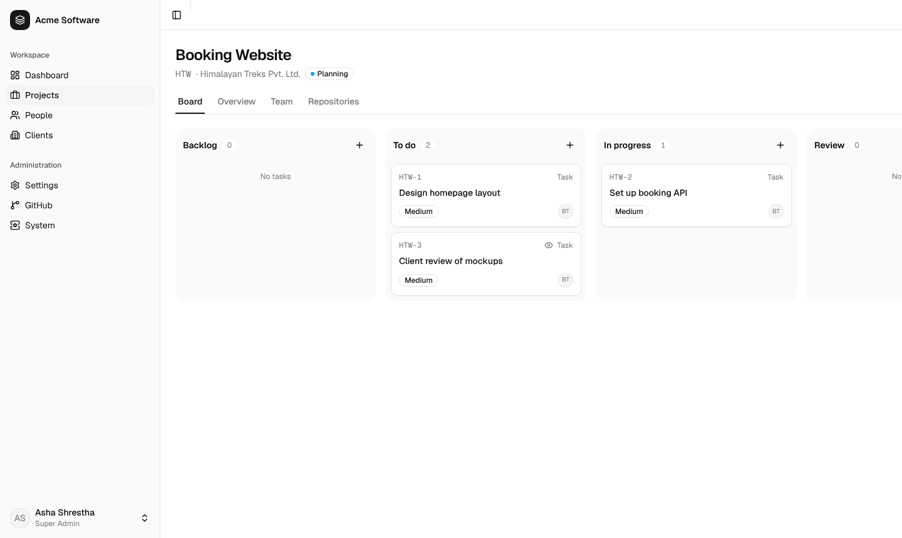
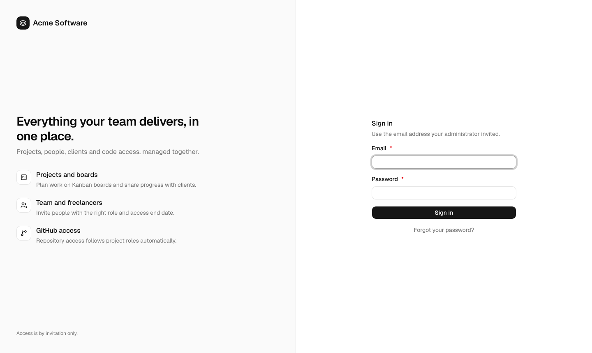
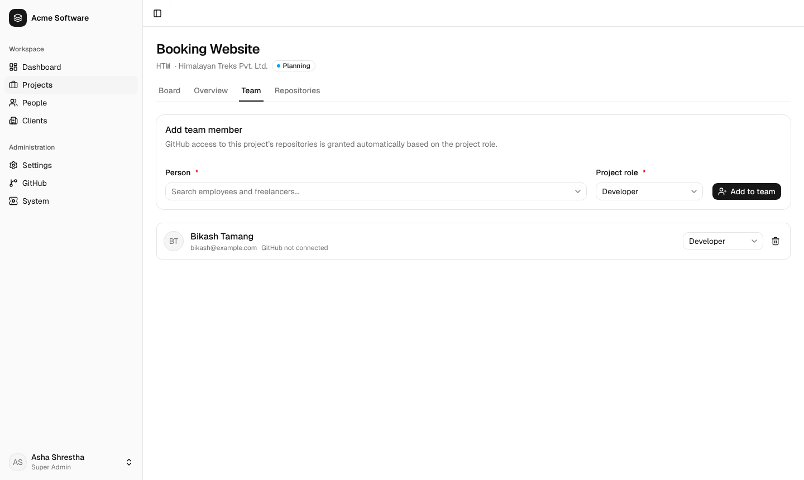
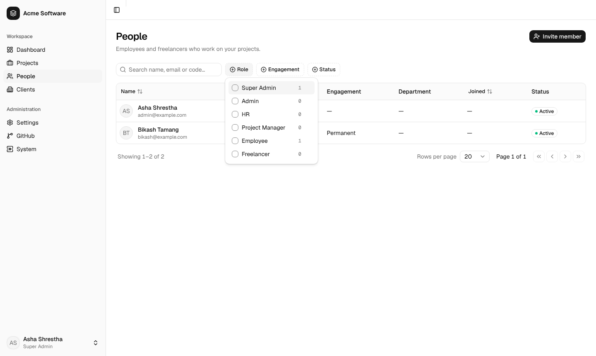
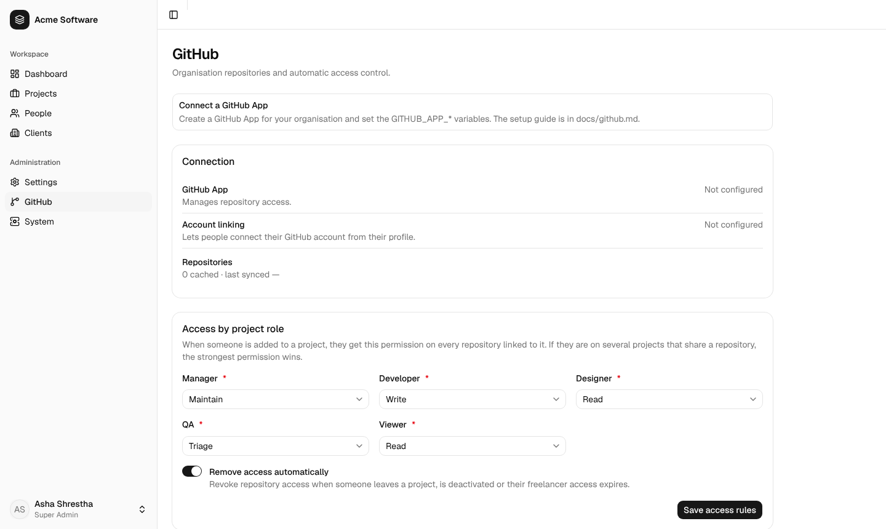

<div align="center">

# KaamHub

**The open-source operating system for IT companies and digital agencies.**

Projects and Kanban boards, employees and freelancers, clients with their own portal, and GitHub repository access that follows your team automatically. Self-hosted on your own server, updated in one click.

[](https://github.com/klixsoft/kaamhub/actions/workflows/ci.yml)
[](https://github.com/klixsoft/kaamhub/releases)
[](LICENSE)
[](https://nextjs.org)
[](https://www.postgresql.org)

[Features](#features) · [Screenshots](#screenshots) · [Quick start](#quick-start) · [Deploy](#deploy-on-your-own-server) · [Docs](#documentation) · [Roadmap](#roadmap) · [Contributing](#contributing)



</div>

---

## Why KaamHub?

*Kaam* (काम) means **work** in Nepali.

Most IT companies run on a patchwork of tools: one for tasks, a spreadsheet for staff, a shared drive for client updates and a person who remembers to add or remove developers on GitHub. KaamHub puts the day-to-day running of a software company in one place that you own:

- **One source of truth** for projects, people, clients and code access.
- **Clients see progress** on a read-only board without seeing your internal work.
- **Access follows the team.** Add a developer to a project and they get the repositories; remove them, or let a freelancer's contract end, and the access goes away.
- **Your data stays on your server.** It is a single Docker Compose stack with PostgreSQL, so there is no per-seat pricing and no vendor lock-in.
- **Built to be extended.** It is a clean, typed Next.js codebase with documented patterns, so your team can add what your company needs.

---

## Features

### Projects and Kanban boards
- Projects with code, client, type, priority, status, start date and deadline
- A Kanban board for every project with drag and drop by **mouse, touch or keyboard**
- Optimistic updates with automatic rollback if the server rejects a move
- Tasks with type (task, feature, bug, improvement), priority, multiple assignees, due date, estimate and description
- Readable task IDs per project, e.g. `WEB-42`
- Per-task visibility: **internal** or **visible to client**
- Progress per project based on completed tasks

### Client portal
- Invite people from a client company; they set their own password
- Clients only ever see **their own company's projects**
- A read-only board that shows only client-visible tasks
- Internal sections (team, repositories, people, settings) are blocked for clients

### People and freelancers
- Invite employees and freelancers by email
- Seven system roles: **Super Admin, Admin, HR, Project Manager, Employee, Freelancer, Client**
- Department, designation, reporting manager, employee code, phone, joining date and contract end date
- **Freelancer access expiry**: sign-in and GitHub access stop automatically on the date you set
- Deactivate or reactivate with one click; deactivation signs the person out everywhere immediately

### GitHub integration
- Connects to your organisation through a **GitHub App** with minimal permissions
- Link **several repositories to one project** (frontend, backend, mobile, infrastructure, docs)
- Create new organisation repositories without leaving the project
- Team members connect their GitHub account from their profile
- **Automatic access by project role**, configurable per role (e.g. Manager → Maintain, Developer → Write, Viewer → Read); when someone has several roles, the strongest permission wins
- Access is removed when someone leaves a project, is deactivated or their freelancer access expires
- Per-repository, per-person status: *Active*, *Invitation sent* or *Failed*, with the reason
- A webhook keeps the repository list in sync

### Administration
- First-run setup screen that creates the first super admin
- Company name, project code prefix, departments and designations
- Audit log of invitations, role changes, project, repository and settings changes, and updates
- **One-click updates**: KaamHub checks GitHub Releases and updates its own containers, similar to Dokploy

### Built for production
- **Fast lists**: server-side search, facet filters with live counts, sorting and pagination
- **No N+1 queries**: every list runs a fixed number of SQL queries regardless of size
- **Instant page shells** with Partial Prerendering; data streams in behind skeletons
- **Secure by default**: invite-only accounts, rate-limited sign-in, permission checks on every query and action, strict security headers, a non-root container and signed webhooks
- **Accessible**: labelled forms, keyboard support, visible focus, and dark mode

---

## Screenshots

| Sign in | Projects |
|---|---|
|  |  |

| Task editor | Team and GitHub access |
|---|---|
|  |  |

| People with facet filters | GitHub settings |
|---|---|
|  |  |

---

## Tech stack

| Layer | Technology |
|---|---|
| Framework | [Next.js 16](https://nextjs.org) (App Router, Server Actions, Cache Components) |
| Language | TypeScript (strict) |
| UI | [shadcn/ui](https://ui.shadcn.com) on Base UI, Tailwind CSS 4, lucide icons |
| Database | PostgreSQL with [Drizzle ORM](https://orm.drizzle.team) |
| Auth | [Better Auth](https://www.better-auth.com) |
| Drag and drop | [dnd-kit](https://dndkit.com) |
| Validation | [zod](https://zod.dev) |
| GitHub | GitHub App via [Octokit](https://github.com/octokit) |
| Deployment | Docker, Docker Compose, GitHub Actions, GitHub Container Registry |

---

## Quick start

Requirements: **Node.js 22+** and **PostgreSQL 15+**.

```bash
git clone https://github.com/klixsoft/kaamhub.git
```

```bash
cd kaamhub && npm install && cp .env.example .env.local
```

Set `DATABASE_URL` and `BETTER_AUTH_SECRET` in `.env.local` (generate a secret with `openssl rand -base64 48`), then:

```bash
npm run db:migrate
```

```bash
npm run dev
```

Open <http://localhost:3000>. You will be taken to **/setup** to create the first super admin.

> Without SMTP settings, invitation and password emails are printed to the server log, so you can try every flow locally.

Full guide: [docs/development.md](docs/development.md)

---

## Deploy on your own server

KaamHub ships as Docker images built by GitHub Actions:

- `ghcr.io/klixsoft/kaamhub`
- `ghcr.io/klixsoft/kaamhub-updater`

On any Linux VPS with Docker:

```bash
mkdir -p /opt/kaamhub && cd /opt/kaamhub
```

```bash
curl -fsSLO https://raw.githubusercontent.com/klixsoft/kaamhub/main/docker-compose.yml
```

```bash
curl -fsSL https://raw.githubusercontent.com/klixsoft/kaamhub/main/.env.production.example -o .env
```

Fill in `.env`, then start the stack:

```bash
docker compose up -d
```

Put a reverse proxy with HTTPS (Caddy or Nginx) in front of port 3000. Database migrations run automatically when the container starts.

Full guide, including HTTPS, backups and updates: [docs/deployment.md](docs/deployment.md)

### Updating

Open **System** in the sidebar. When a new release is available, click **Update**. KaamHub pulls the new image, restarts, applies migrations and reloads the page when it is back. You can also update manually with `docker compose pull && docker compose up -d`.

---

## Roles and permissions

| Capability | Super Admin | Admin | HR | Project Manager | Employee | Freelancer | Client |
|---|:-:|:-:|:-:|:-:|:-:|:-:|:-:|
| Dashboard | ✓ | ✓ | ✓ | ✓ | ✓ | ✓ | |
| See all projects | ✓ | ✓ | | | | | |
| See assigned projects | ✓ | ✓ | ✓ | ✓ | ✓ | ✓ | |
| See own company's projects (read-only) | | | | | | | ✓ |
| Create projects | ✓ | ✓ | | ✓ | | | |
| Manage any project | ✓ | ✓ | | | | | |
| View people | ✓ | ✓ | ✓ | ✓ | | | |
| Invite and edit people | ✓ | ✓ | ✓ | | | | |
| View clients | ✓ | ✓ | ✓ | ✓ | | | |
| Edit clients | ✓ | ✓ | | | | | |
| Settings and GitHub | ✓ | ✓ | | | | | |
| System updates | ✓ | | | | | | |

Inside a project, the **project role** decides what someone can do: Managers manage the project and team, Developers, Designers and QA edit tasks, and Viewers are read-only. Anyone who is a Manager on a project can manage that project, whatever their system role.

All permissions are defined in one file: [`src/config/roles.ts`](src/config/roles.ts).

---

## Documentation

| Guide | What it covers |
|---|---|
| [Development](docs/development.md) | Local setup, scripts and database migrations |
| [Architecture](docs/architecture.md) | Folder structure, data access, authorization and reusable components |
| [Deployment](docs/deployment.md) | Docker Compose on a VPS, HTTPS, backups and updates |
| [GitHub integration](docs/github.md) | Creating the GitHub App and how access sync works |
| [Contributing](CONTRIBUTING.md) | Workflow and code guidelines |
| [Security](SECURITY.md) | Reporting vulnerabilities and the security model |

---

## Roadmap

- [ ] **Invoices and VAT bills** following Nepal's tax invoice format, with A4 PDF output and client delivery
- [ ] **Managed services**: domain, hosting and maintenance per project, with recurring billing and expiry reminders
- [ ] **Company letters** on your letterhead (offer letter, contract, NDA, experience letter) with configurable page offsets
- [ ] **My letters** on employee profiles
- [ ] Time tracking and timesheets
- [ ] Attendance and leave, with Bikram Sambat (BS) dates
- [ ] Support tickets from the client portal
- [ ] Commits and pull requests linked to tasks
- [ ] Two-factor authentication

Have an idea? [Open a feature request](https://github.com/klixsoft/kaamhub/issues/new?template=feature_request.yml).

---

## Contributing

Contributions are welcome, from bug reports to new modules. Please read [CONTRIBUTING.md](CONTRIBUTING.md) before opening a pull request, and use [Conventional Commits](https://www.conventionalcommits.org/) for commit messages.

If you find a security issue, please report it privately as described in [SECURITY.md](SECURITY.md).

## License

KaamHub is open-source software licensed under the [MIT License](LICENSE).

<div align="center">
<sub>Made in Nepal 🇳🇵 by <a href="https://github.com/klixsoft">Klixsoft</a> and contributors.</sub>
</div>
